<div align="center">

# 🌱 AgriQNet 2.0

**A multilingual farm assistant with quantum-hybrid crop and fertilizer recommenders, YOLOv8 pest detection, a district-level pest-alert SMS network, a citation-backed farm library (RAG) and agro-weather alerts — all started with one command.**

`React + Vite` · `Node/Express gateway` · `FastAPI micro-services` · `MongoDB` · `scikit-learn + NumPy statevector simulator` · `YOLOv8` · `multilingual RAG`

ಕನ್ನಡ · हिंदी · తెలుగు · English

</div>

<p align="center">
  
  <br><sub><b>Figure 1.</b> Farmer home: district weather, nearby pest alerts and six picture tiles.</sub>
</p>

---

## Contents

1. [What AgriQNet does](#1-what-agriqnet-does)
2. [System architecture](#2-system-architecture)
3. [How the quantum-hybrid models were trained](#3-how-the-quantum-hybrid-models-were-trained)
4. [Components and services](#4-components-and-services)
5. [The web app in screenshots](#5-the-web-app-in-screenshots)
6. [Set up and run](#6-set-up-and-run)
7. [Configuration](#7-configuration)
8. [Repository layout](#8-repository-layout)
9. [Publish to GitHub](#9-publish-to-github)

---

## 1. What AgriQNet does

| Farmer need | AgriQNet feature | Powered by |
|---|---|---|
| *"Which crop suits my soil?"* | **Which crop?** – soil and weather readings in, crop out, with confidence | AgriQNet v3 quantum-hybrid model (7 simulated qubits) |
| *"Which fertilizer, how much?"* | **Fertilizer** – N/P/K (or 8 inputs) in, fertilizer out; GenAI plan with dosage | Quantum-hybrid model (3 or 6 qubits) + Gemini |
| *"What is eating my crop?"* | **Pest photo** – photo → pest name → what to do → warn neighbours | YOLOv8 trained on IP102 (102 pests) |
| *"Is something coming my way?"* | **Alerts** and the officer's **Alert Network** map, SMS in the farmer's language | District graph + breadth-first search + Twilio |
| *"Will it rain? Can I spray?"* | **Weather** – district weather, 16-day forecast, rule-based farm alerts | OpenWeather + Open-Meteo |
| *"What does ICAR say about this?"* | **Farmer Library** – ask one book or the whole shelf; answers cite pages | AgriRAG: hybrid search + reranker + Groq/Gemini |
| *"Just tell me"* | **Ask** – district-aware chat, voice input and read-aloud | Gemini → Groq fallback, Sarvam TTS |

Designed for farmers first: language picked on the first screen, district instead of GPS, picture buttons with plain words, a **🔊 Listen** button on every card, a phone bottom bar, and SMS for family members on basic phones.

---

## 2. System architecture

### 2.1 Big picture

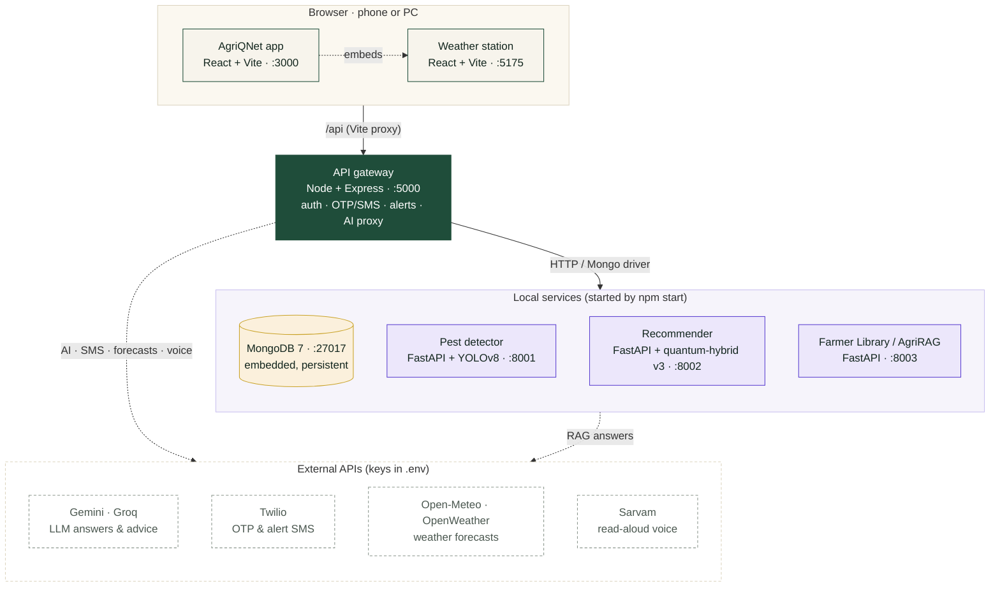

| Service | Folder | Port | Tech | Role |
|---|---|---|---|---|
| AgriQNet app | `apps/web` | 3000 | React 19, Vite 6, Motion, d3-geo | Farmer + officer UI, Alert Network map |
| Weather station | `apps/weather` | 5175 | React, Tailwind, Vite | Weather, 16-day forecast, farm alerts |
| API gateway | `services/api` | 5000 | Node 18+, Express, Mongoose | One front door: auth, OTP, SMS, alerts, AI, proxies |
| MongoDB | `services/api/src/mongo-server.js` | 27017 | mongodb-memory-server (persistent) | Users, farmers, districts, alerts, SMS log |
| Pest detector | `services/pest-detector` | 8001 | FastAPI, Ultralytics YOLOv8 | 102-class IP102 pest detection |
| Recommender | `services/recommender` | 8002 | FastAPI, scikit-learn 1.7.2, NumPy | Quantum-hybrid crop & fertilizer models |
| Farmer Library | `services/agri-rag` | 8003 | FastAPI, PyMuPDF, multilingual-e5, BM25 | Book ingestion, per-book index, cited answers |

A single launcher (`scripts/launcher.mjs`) installs dependencies on first run, starts the services in order (MongoDB → API → Python services → frontends), waits for their health checks, and stops everything cleanly on **Ctrl+C**.

### 2.2 One request, end to end

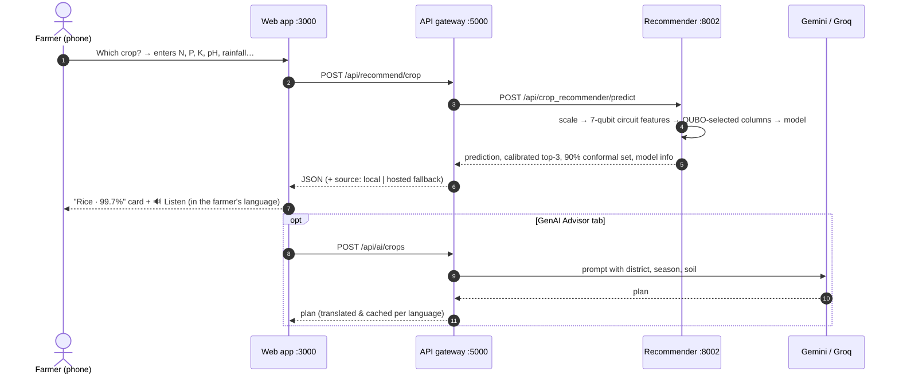

### 2.3 Data model (MongoDB)

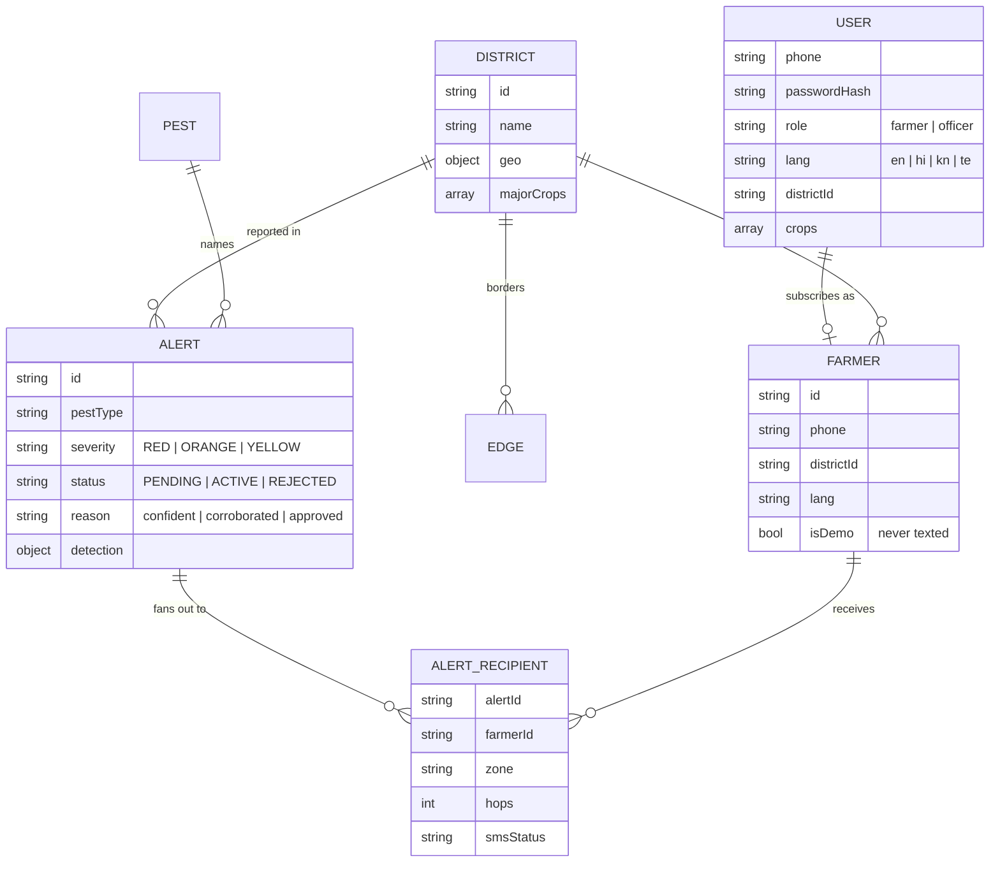

Other collections: `Otp` (hashed, rate-limited codes), `SmsLog` (outbox), `Advice` (weekly district tips cached per day and language), `Counter` (atomic IDs).

---

## 3. How the quantum-hybrid models were trained

> This section follows the project presentation *AgriQNet: Hybrid Quantum ML for Farmers*. All circuits are **classically simulated** (3–7 qubits); no quantum computational advantage is claimed.

### 3.1 The question

New districts and new crops start with very few soil tests. AgriQNet asks: **can quantum computing help a classical model pick the right crop or fertilizer from only a handful of farm examples?**

The test is deliberately narrow and fair: take one standard model — the **support vector machine (SVM)** — build two quantum-upgraded versions, give all three exactly the same farms, and score them only on farms they have never seen.

| Dataset | Farms | Inputs | Predicts |
|---|---|---|---|
| Crop | 2,200 (100 per crop) | N, P, K, temperature, humidity, pH, rainfall | 1 of 22 crops |
| Fertilizer · NPK | 99 | N, P, K | 1 of 7 fertilizers |
| Fertilizer · 8 inputs | 99 | N, P, K, temperature, humidity, moisture, soil type, crop type | 1 of 7 fertilizers |

### 3.2 From soil readings to qubits

1. **Scale** each reading to between −1 and +1 (fitted on training farms only).
2. **Turn** a qubit by that value: `RY(s · x)`. The *bandwidth* `s` controls how strongly a change in the reading turns the qubit (small `s`: farms look alike; large `s`: small differences look big). Values 0.5–2 are explored.
3. **Link** qubits with CNOT gates in a ring (N → K → P → N), so the state depends on *combinations* of nutrients, not just each one alone.
4. **Measure** expectation values ⟨X⟩, ⟨Y⟩, ⟨Z⟩ on each qubit and ⟨XX⟩, ⟨YY⟩, ⟨ZZ⟩ on pairs — each average becomes one feature.

### 3.3 Two quantum upgrades for the classical SVM

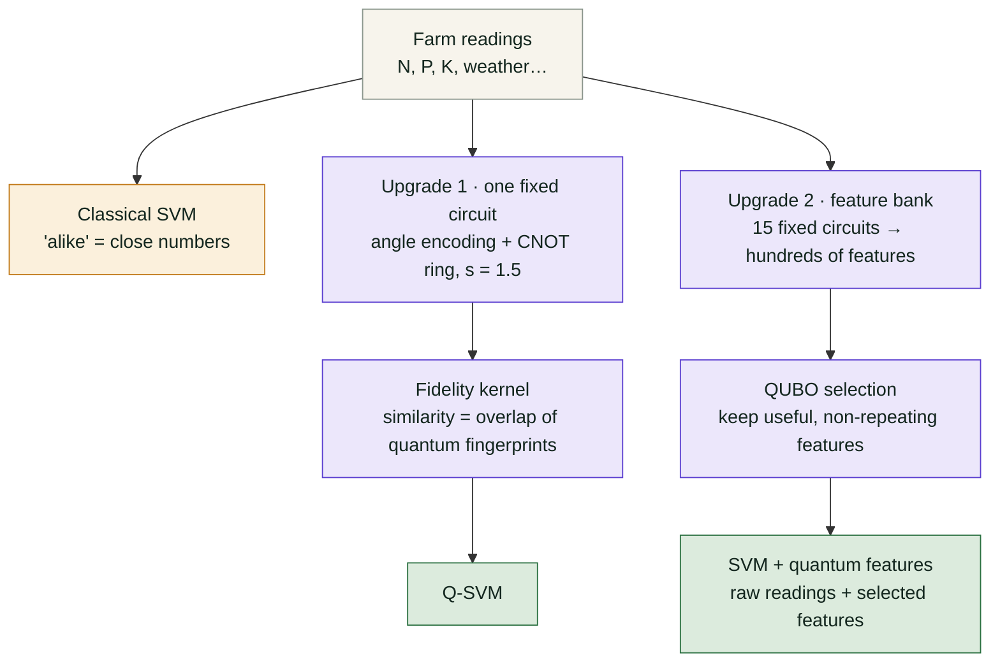

**Upgrade 1 – Q-SVM (quantum similarity).** Every farm passes through the same small circuit and comes out as a quantum *fingerprint*. The SVM judges how alike two farms are by how much their fingerprints overlap (the *kernel matrix*). Only the meaning of "similar" changes; the SVM itself is unchanged.

**Upgrade 2 – SVM + quantum features (better inputs).** A **feature bank** of 15 fixed, never-trained circuits views each farm in different ways:

| Circuit design | Strengths `s` | What it does |
|---|---|---|
| Separable | 0.5, 1, 1.5, 2 | Turns only, no links |
| Angle + CNOT | 1, 1.5 | Turns, then links neighbours |
| IQP | 0.5, 1, 1.5 | Links every pair (N with K directly) |
| Heisenberg | 0.5, 1, 2 | Qubits interact step by step |
| Re-uploading | 0.5, 1, 1.5 | Readings fed in three times |

That gives **1,008** features per crop farm (7 qubits), **234** per NPK farm (3) and **765** per 8-input farm (6). With only 99 fertilizer farms, using them all would memorise noise, so a **QUBO** (quadratic unconstrained binary optimisation) makes a yes/no choice for each feature that rewards *relevance to the answer* and penalises *pairs that say the same thing* (Mücke et al. relevance–redundancy objective). It keeps 1–8 features for fertilizer and 2–14 for crop.

QAOA, a quantum algorithm for QUBO, was tested too: it came close (approximation ratio 0.98–0.99) but rarely found the exact optimum, so a classical solver (exact search / simulated annealing) does the selection. The most frequently chosen fertilizer feature was an entangled **N-with-K correlator ⟨Y₃Y₄⟩**, picked in 83% of folds.

### 3.4 Training pipeline

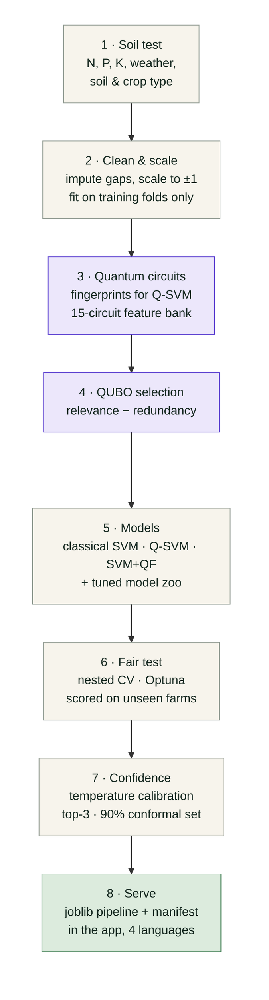

- **Circuits stay fixed; only the classical model learns.** Trainable circuits are slow and often get stuck; fixed ones keep the comparison fair.
- **Nothing leaks.** Scaling, imputation, feature building and QUBO selection all live inside one scikit-learn `Pipeline`, fitted inside each training fold.
- **Tuning.** Optuna tries 30 (crop) or 40 (fertilizer) combinations — number of features, circuit strength `s`, SVM strictness — scored on inner practice splits.
- **Statistics.** Nadeau–Bengio corrected t-tests with Holm correction against raw features of the same learner; Wilcoxon/sign tests over paired learning-curve runs.
- **Full study.** Ran on Modal (parallel CPU containers + GPUs for TabPFN): 861 work units, 52.6 min, 0 failures.

**The few-example test (how the results below were measured).** Pick a few farms at random (for example 2 per crop), train all three SVMs on exactly those farms, test on every farm they did not see, repeat 20 times (crop) or 40 times (fertilizer), average, then add more farms. All settings were fixed in advance so no SVM gets an unfair edge.

### 3.5 Results

<p align="center">
  
  <br><sub><b>Figure 2.</b> Crop: both quantum upgrades beat the classical SVM when farms are few (2–16 per crop); all meet near 98% at 32 per crop.</sub>
</p>

<p align="center">
  
  <br><sub><b>Figure 3.</b> Fertilizer (8 inputs): QUBO-selected quantum features lift the SVM from 0.45 to 0.73 macro-F1 at 64 farms (+28.6 points).</sub>
</p>

<p align="center">
  
  <br><sub><b>Figure 4.</b> Takeaway: quantum upgrades help on 2 of 3 datasets, and only when examples are few.</sub>
</p>

**Why it works:** the circuits give the SVM a richer sense of which farms are alike, including combinations such as N with K. On the 8-input fertilizer data, weather, soil type and crop type say little about the right bag and drown out the nutrients for a distance-based SVM; nutrient-derived quantum features put the focus back. **When it matters:** with few examples. With plenty of data the classical model catches up.

**Honest scope (full-data nested CV):** at full data no quantum arm was significantly better than raw features of the same learner (21 comparisons, all non-significant), and separable (no-entanglement) circuits did as well as or better than entangled ones — the useful ingredient is the structured, bandwidth-limited trigonometric encoding, which is classically simulable.

### 3.6 What the app actually serves

The platform ships the best **quantum-hybrid** pipeline from the full-budget study for each task (non-inferior to the best classical model, 99.5–100% out of fold):

| Task | Served model | Qubits | Nested-CV result |
|---|---|---|---|
| Crop (`models/v3/crop`) | Gaussian NB on the 7 readings + QUBO-selected circuit features | 7 | accuracy 99.41%, log-loss 0.0165 |
| Fertilizer NPK (`models/v3/fert_npk`) | Soft vote: SVM + quantum features, quantum fidelity-kernel SVM (IQP), ExtraTrees + quantum features | 3 | macro-F1 0.993 |
| Fertilizer 8 inputs (`models/v3/fert_full8`) | ExtraTrees + QUBO-selected features incl. ⟨Y₃Y₄⟩ | 6 | macro-F1 0.995 |

Every response carries a calibrated **top-3**, a **90% conformal set** and the model ID. At start-up each model re-predicts a stored sample and must match to within 1e-6, otherwise the service falls back to the v1 models and reports it on `/health`.

---

## 4. Components and services

### 4.1 Recommender service (`:8002`)

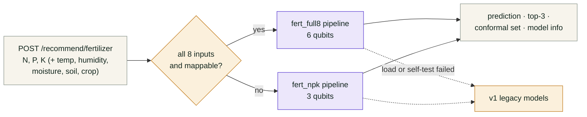

Inside each pipeline: imputer → scaler → **NumPy statevector simulator** (bundled `agriqnet` package, exact expectation values, 5–100 ms per request) → selected quantum columns → classifier → temperature calibration → conformal set. No PennyLane, GPU or PyTorch is needed at inference. App soil names map to the training categories (e.g. *Red Soil → Red*, *ragi → Millets*).

### 4.2 Pest detection and the pest-alert network

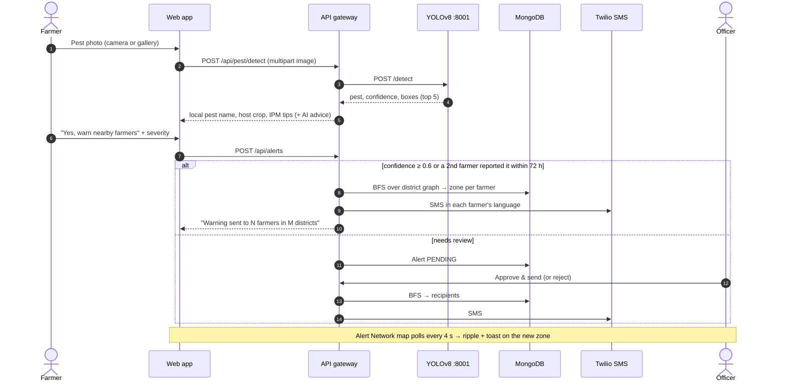

**Zones by graph distance.** The 31 Karnataka districts and 71 borders form a graph. Severity sets how far the warning spreads; hop distance sets each farmer's zone.

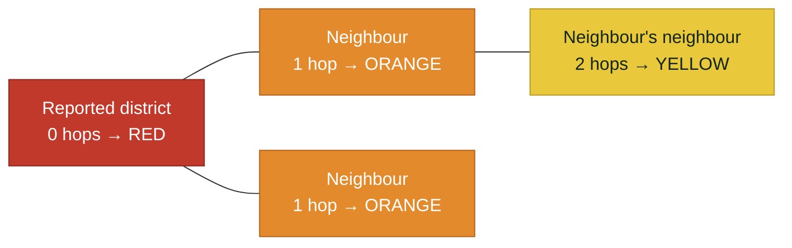

| Severity chosen | Spread (BFS depth) | Who is texted |
|---|---|---|
| 🔴 Very bad | 2 hops | Reported district, neighbours and their neighbours |
| 🟠 Spreading | 1 hop | Reported district and neighbours |
| 🟡 A few pests | 0 hops | Reported district only |

Seeded demo farmers are flagged `isDemo` and are never texted; `SMS_MODE=simulate` records messages without sending. Only officers can approve, reject or cancel alerts and see phone numbers.

### 4.3 Farmer Library — AgriRAG (`:8003`)

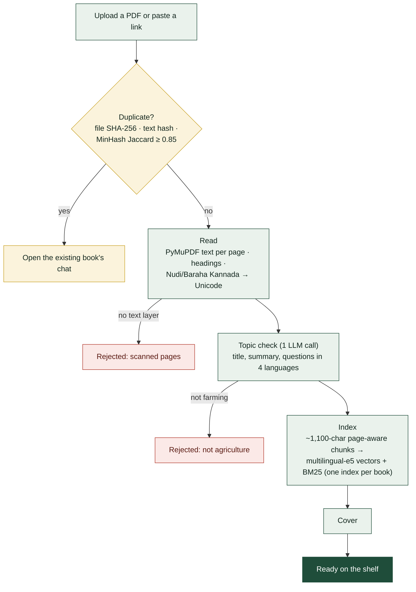

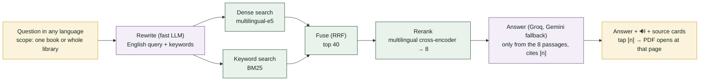

Why one index per book: *Ask this book* can only ever see that book, hiding or adding a book never rewrites another index, and a laptop-sized library fits in memory for exact search. More detail: [`services/agri-rag/docs/HOW-AGRIRAG-WORKS.md`](services/agri-rag/docs/HOW-AGRIRAG-WORKS.md).

### 4.4 Weather service and weekly district advice

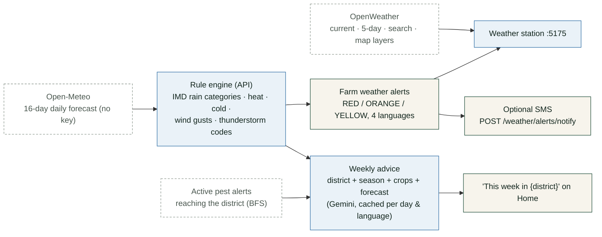

Thresholds: rain ≥ 35.5 mm (yellow), ≥ 64.5 mm (orange), ≥ 115.6 mm (red); max temperature ≥ 40 °C (orange), ≥ 45 °C (red); min ≤ 8 °C; gusts ≥ 50 / ≥ 70 km/h.

### 4.5 API gateway (`:5000`)

| Area | Endpoints |
|---|---|
| Accounts | `POST /auth/check-user`, `/auth/register`, `/auth/login` · `PUT /auth/profile` (bcrypt passwords, signed tokens) |
| OTP & SMS | `POST /otp/send`, `/otp/verify`, `/sms/send` · `GET /sms/log`, `/sms/status` |
| Pest alerts | `GET/POST /districts`, `/districts/edges`, `/farmers`, `/alerts`, `/subscriptions`, `/pests` · officer: `POST /alerts/:id/approve`, `/alerts/:id/reject`, `PUT /alerts/:id/cancel` |
| Detection | `POST /pest/detect` (multipart `image`; `?fallback=gemini`) |
| Recommenders | `POST /recommend/crop`, `/recommend/fertilizer` |
| Farmer Library | `GET /library/books`, `POST /library/upload`, `/library/url`, `/library/chat` |
| Weather | `GET /weather/now`, `/weather/forecast`, `/weather/alerts` · `POST /weather/alerts/notify` |
| Helpers | `GET /advice`, `POST /ai/translate`, `POST /tts`, `POST /ai/*` (Gemini → Groq) |
| Health | `GET /health` (or `npm run status`) |

All AI keys stay on the server; the browser never sees them.

---

## 5. The web app in screenshots

Captured from the running app at `http://localhost:3000`. The images, their titles and captions are in [`docs/demo_assets/`](docs/demo_assets) with a [`manifest.json`](docs/demo_assets/manifest.json) in story order, ready to reuse as demo-video scenes; PNG renders of every diagram in this README are in [`docs/diagrams/`](docs/diagrams).

### Getting started

<table>
<tr>
<td align="center" width="25%"><br><sub><b>Fig. 5</b> Choose your language</sub></td>
<td align="center" width="25%"><br><sub><b>Fig. 6</b> Login and demo accounts</sub></td>
<td align="center" width="25%"><br><sub><b>Fig. 7</b> Farmer home (phone)</sub></td>
<td align="center" width="25%"><br><sub><b>Fig. 8</b> Instant switch to Kannada</sub></td>
</tr>
</table>

### Crop and fertilizer recommenders (quantum-hybrid)

<table>
<tr>
<td align="center" width="25%"><br><sub><b>Fig. 9</b> Crop model inputs</sub></td>
<td align="center" width="25%"><br><sub><b>Fig. 10</b> Rice · 99.7% · 7 simulated qubits</sub></td>
<td align="center" width="25%"><br><sub><b>Fig. 11</b> Fertilizer calculator</sub></td>
<td align="center" width="25%"><br><sub><b>Fig. 12</b> Urea · 3 simulated qubits</sub></td>
</tr>
</table>

### Pest photo → warning

<table>
<tr>
<td align="center" width="20%"><br><sub><b>Fig. 13</b> Take or choose a photo</sub></td>
<td align="center" width="20%"><br><sub><b>Fig. 14</b> YOLOv8 names the pest</sub></td>
<td align="center" width="20%"><br><sub><b>Fig. 15</b> What to do now</sub></td>
<td align="center" width="20%"><br><sub><b>Fig. 16</b> How bad is it?</sub></td>
<td align="center" width="20%"><br><sub><b>Fig. 17</b> Districts that get the SMS</sub></td>
</tr>
</table>

### Alerts and the Alert Network

<table>
<tr>
<td align="center" width="25%"><br><sub><b>Fig. 18</b> Alerts for my district</sub></td>
<td align="center" width="25%"><br><sub><b>Fig. 19</b> Weather alerts · SMS for basic phones</sub></td>
<td align="center" width="50%"><br><sub><b>Fig. 20</b> Alert Network: red/orange zones around an outbreak</sub></td>
</tr>
</table>

<p align="center"><br><sub><b>Fig. 21</b> Officer view: districts, registered farmers, active alerts and history</sub></p>

### Weather

<table>
<tr>
<td align="center" width="50%"><br><sub><b>Fig. 22</b> Weather station for the farmer's district</sub></td>
<td align="center" width="50%"><br><sub><b>Fig. 23</b> AI farm decisions + 16-day forecast</sub></td>
</tr>
</table>

### Farmer Library and Ask

<table>
<tr>
<td align="center" width="50%"><br><sub><b>Fig. 24</b> Farmer Library shelf</sub></td>
<td align="center" width="50%"><br><sub><b>Fig. 25</b> Ask a book — answers cite pages</sub></td>
</tr>
<tr>
<td align="center" width="50%"><br><sub><b>Fig. 26</b> Ask anything (district-aware assistant)</sub></td>
<td align="center" width="50%"><br><sub><b>Fig. 27</b> Six picture tiles with read-aloud</sub></td>
</tr>
</table>

---

## 6. Set up and run

**Prerequisites:** Node.js ≥ 18.17 (LTS), Python 3.10–3.13, Git, about 3 GB free disk. MongoDB, PyTorch and the models are installed by the launcher.

```bash
# 1. Get the code
git clone https://github.com/Akash-Sakala/AgriQNet-2.0.git
cd AgriQNet-2.0

# 2. Configure (the launcher also creates .env from .env.example on first run)
cp .env.example .env            # Windows PowerShell: Copy-Item .env.example .env
#    then add GEMINI_API_KEY, GROQ_API_KEY and VITE_OPENWEATHER_API_KEY (see §7)

# 3. Install everything and start all services
npm start                       # first run ≈ 10–15 min (npm, Python venv, PyTorch CPU, models)

# 4. Open the app
#    http://localhost:3000   → choose a language → "Try demo" or "Officer demo"
```

| Demo account | Phone | Password |
|---|---|---|
| Farmer (Bengaluru Urban) | `+91 0000000000` | `demo1234` |
| Agriculture officer | `+91 0000000001` | `officer123` |
| Second farmer, Lakshmi | `+91 0000000002` | `demo1234` |

Everyday commands:

```bash
npm start                         # set up if needed, then start everything
npm start -- --open               # …and open the browser
npm start -- --only=api,web       # start only some services (MongoDB is added automatically)
npm start -- --skip=rag,weather   # start everything except some services
npm run demo                      # clean demo data with zero pest alerts (live demo)
npm run demo:reset                # reset demo data while running
npm run reseed                    # wipe and reseed demo data (with sample alerts), then start
npm run status                    # health of every service
npm run build                     # production builds of both frontends
npm run i18n && npm run i18n:check   # fill / verify Hindi, Kannada, Telugu strings
```

Live-demo script (an outbreak filling the Karnataka map): [`demo-photos/README.md`](demo-photos/README.md). Twilio trial setup and translation workflow: [`docs/platform-notes.md`](docs/platform-notes.md).

Press **Ctrl+C** once to stop everything; MongoDB shuts down cleanly and data is kept. Runtime files (venv, MongoDB data, logs, Farmer Library) live outside the repo in `%LOCALAPPDATA%\AgriQNet` (Windows) or `~/.agriqnet` (macOS/Linux); override with `AGRIQNET_HOME`.

<details>
<summary><b>Troubleshooting</b></summary>

- **Port already in use** — an old copy is still running; close it or change the port in `.env`.
- **First start is slow** — the Python services download PyTorch, YOLO and the embedding models once.
- **Logs** — `%LOCALAPPDATA%\AgriQNet\logs\<service>.log`.
- **Fresh database** — stop, delete `%LOCALAPPDATA%\AgriQNet\mongo-data`, `npm start`.
- **Reinstall Python packages** — delete `%LOCALAPPDATA%\AgriQNet\venv`, `npm start`.
- **Slow book processing** — set `RAG_EMBED_MODEL=intfloat/multilingual-e5-small`.
- **Gemini free tier exhausted** — the API falls back to other Gemini models, then Groq (text features).

</details>

---

## 7. Configuration

One `.env` at the repository root configures every service (template: `.env.example`). **Never commit `.env`** — it is in `.gitignore`.

| Key | Needed for |
|---|---|
| `GEMINI_API_KEY`, `GEMINI_MODEL` | Ask, GenAI crop/fertilizer plans, pest advice, weekly advice, translation |
| `GROQ_API_KEY`, `GROQ_MODEL`, `GROQ_FAST_MODEL` | Farmer Library answers and query rewriting (Gemini fallback) |
| `VITE_OPENWEATHER_API_KEY` | Weather station current weather, 5-day forecast, search, map layers |
| `SMS_MODE` (`auto` / `simulate`), `TWILIO_*` | OTP and pest/weather SMS (a Twilio trial texts verified numbers only) |
| `SARVAM_API_KEY` | Natural Kannada/Telugu/Hindi read-aloud when the device has no voice |
| `AUTO_ALERT_CONFIDENCE` (0.6) | Photo confidence needed to send a farmer's report without an officer |
| `RECOMMENDER_MODELS` (`v3` / `legacy`) | Quantum-hybrid v3 models (default) or the original v1 models |
| `RAG_EMBED_MODEL`, `RAG_RERANK_MODEL`, `HF_TOKEN`, `LIBRARY_*` | Farmer Library models, covers, autoseed and crawl schedule |
| `MONGO_URI` | Leave empty for the embedded MongoDB, or point to Atlas/your server |
| `*_PORT`, `AGRIQNET_HOME` | Ports and the runtime folder |

---

## 8. Repository layout

```
agriqnet-platform/
├── apps/
│   ├── web/                 # AgriQNet app (React + Vite) — farmer & officer UI, Alert Network
│   ├── weather/             # Weather station (React + Tailwind)
│   └── pest-dashboard/      # legacy dashboard (replaced by Alert Network; not started)
├── services/
│   ├── api/                 # Express gateway, Mongo models, seed data, i18n, alert engine
│   ├── pest-detector/       # FastAPI + YOLOv8 (best.pt, IP102)
│   ├── recommender/         # FastAPI + quantum-hybrid v3 models + bundled `agriqnet` simulator
│   ├── agri-rag/            # Farmer Library (AgriRAG) + docs/HOW-AGRIRAG-WORKS.md
│   └── requirements.txt     # shared Python requirements
├── scripts/                 # launcher, status check, i18n translator
├── demo-photos/             # sample pest photos + live-demo script
├── docs/
│   ├── images/results/      # model result figures
│   ├── diagrams/            # PNG renders of the Mermaid diagrams in this README
│   ├── demo_assets/         # app screenshots + manifest.json (video scenes)
│   └── platform-notes.md    # previous detailed platform notes (live-demo script, Twilio, i18n)
├── .env.example
└── package.json             # npm start / demo / status / build
```

---

## 9. Publish to GitHub

Run these from the project folder (PowerShell or Git Bash). The remote repository `Akash-Sakala/AgriQNet-2.0` should already exist on GitHub and be empty.

```bash
# 1. Go to the project
cd "C:\Users\akash\OneDrive\Desktop\capstone\Final_Components\agriqnet-platform"

# 2. (optional) keep the stray root PDF out of the repo — it duplicates library-sources/
Add-Content .gitignore "ANNUAL HIGHLIGHTS 2025-26.pdf"     # Git Bash: echo "ANNUAL HIGHLIGHTS 2025-26.pdf" >> .gitignore

# 3. Create the repository on the main branch
git init
git branch -M main

# 4. Stage everything, then check that .env, node_modules/ and library-sources/ are NOT listed
git add .
git status

# 5. Commit
git commit -m "AgriQNet 2.0: platform, quantum-hybrid recommenders, docs and demo assets"

# 6. Connect the GitHub remote and push
git remote add origin https://github.com/Akash-Sakala/AgriQNet-2.0.git
git push -u origin main
```

If `git commit` asks who you are, set it once with `git config --global user.name "Akash Sakala"` and `git config --global user.email "<your GitHub email>"`. If the remote already has a README or licence, run `git pull --rebase origin main` before pushing. The YOLO weights (`services/pest-detector/best.pt`, ~37 MB) are under GitHub's 100 MB file limit, so no Git LFS is needed.

---

<sub>AgriQNet 2.0 · B.E. AI & ML capstone, BMS College of Engineering, Bengaluru. Quantum circuits are simulated classically; results are a benchmark, not a quantum-advantage claim.</sub>
