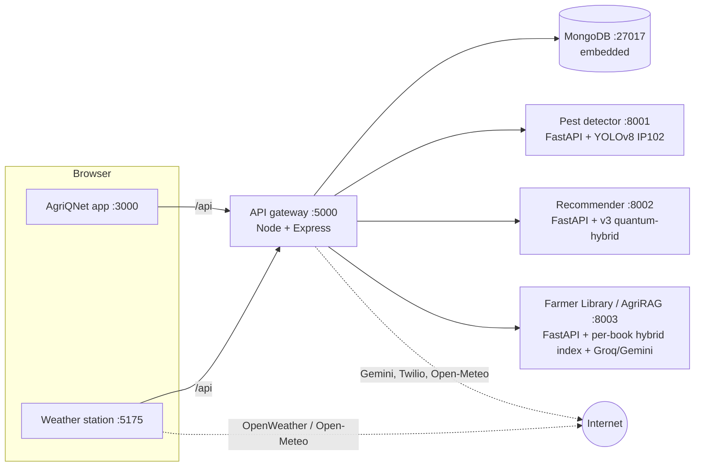

# AgriQNet Platform

AgriQNet brings together crop and fertilizer recommendation (AgriQNet v3 quantum-hybrid models), YOLOv8 pest detection, a district-graph pest-alert network with SMS, the **Farmer Library** (AgriRAG: farm books and reports you can ask questions in your language), and agro-weather alerts. They all start with **one command**.

```bash
cd agriqnet-platform
npm start            # first run installs everything (≈10–15 min), then starts all 8 services
```

Then open **http://localhost:3000**. The first screen asks for the language (ಕನ್ನಡ, हिंदी, తెలుగు or English). Then:

| Account | Phone | Password | Button on the login screen |
|---|---|---|---|
| Demo farmer (Bengaluru Urban, ragi + tomato) | `+91 0000000000` | `demo1234` | *Try demo* |
| Demo agriculture officer | `+91 0000000001` | `officer123` | *Officer demo* |
| Second demo farmer, Lakshmi (same district) | `+91 0000000002` | `demo1234` | — |

or register with your own number (OTP by SMS; the code is shown on screen when SMS is simulated).

Press **Ctrl+C** once to stop everything. MongoDB shuts down cleanly and your data is kept.

---

## What runs



| Service | Folder | Port | Was |
|---|---|---|---|
| AgriQNet app (main frontend, includes the **Alert Network** map that replaced the separate pest dashboard) | `apps/web` | 3000 | `Agriqnet/AgriQNet` + `farmer-pest-alert-system` frontend |
| Weather station | `apps/weather` | 5175 | `weather-app` (was hosted on Render) |
| **API gateway** | `services/api` | 5000 | Merged from `Agriqnet/AgriQNet/server.js` and `farmer-pest-alert-system/backend` |
| YOLO pest detector | `services/pest-detector` | 8001 | `farmer-pest-alert-system/backend/pest_service` |
| Crop/Fertilizer recommender (v3 quantum-hybrid models) | `services/recommender` | 8002 | GitHub `agro_backend` (was hosted on Render); models replaced by AgriQNet v3 |
| Farmer Library (AgriRAG) | `services/agri-rag` | 8003 | `rag-agri` (rebuilt) |
| MongoDB (embedded) | `services/api/src/mongo-server.js` | 27017 | MongoDB Atlas cluster (deleted) |

### API surface (`http://localhost:5000/api`)

- **Accounts:** `POST /auth/check-user`, `/auth/register` (district required, crops optional), `/auth/login` (returns a signed token); `PUT /auth/profile` (language, district, crops). The old `/check-user`, `/register` and `/login` paths still work. Passwords are hashed with bcrypt.
- **OTP and SMS:** `POST /otp/send`, `/otp/verify`, `/sms/send`; `GET /sms/log`, `/sms/status`. SMS and OTP texts are sent in each farmer's saved language.
- **Pest-alert network:** `GET/POST /districts`, `/districts/edges`, `/farmers`, `/alerts` (farmer reports follow the auto-if-confident rule), `/recipients`, `/subscriptions`, `/pests`; officer-only: `POST /alerts/:id/approve`, `/alerts/:id/reject`, `PUT /alerts/:id/cancel`, `GET /sms/setup`, `POST /sms/test`; `GET /test/bfs`.
- **Farmer helpers:** `GET /advice?districtId=&crops=&lang=` (weekly district advice), `GET /weather/now?districtId=`, `POST /ai/translate` (cached), `POST /tts` (Sarvam read-aloud, `GET /tts/status`).
- **Detection:** `POST /pest/detect`, with multipart field `image`. It goes to YOLO; add `?fallback=gemini` to fall back to Gemini Vision.
- **ML:** `POST /recommend/crop`, `/recommend/fertilizer`. They answer with the local AgriQNet v3 quantum-hybrid models (prediction, calibrated top-3, 90% conformal set and the model used); the hosted Render API (old v1 models) is only a fallback if the local service is down. Sending `temperature`, `humidity`, `moisture`, `soil_type` and `crop_type` with N/P/K switches fertilizer to the 8-input model. Details: `services/recommender/README.md`.
- **AI (Gemini):** `POST /ai/chat`, `/ai/crops`, `/ai/fertilizer`, `/ai/pest-image`, `/ai/pest-advice`, `/ai/weather-advice`.
- **Farmer Library:** `GET /library/books`, `GET /library/books/:id` (+ `/cover`, `/file`), `POST /library/upload` (multipart `file`), `POST /library/url`, `GET /library/jobs/:id`, `POST /library/chat` `{message, lang, bookIds, history}`; officers: `POST /library/books/:id/hide`, `POST /library/sources/check`. Old `POST /rag/chat` and `GET /rag/processed` still work. Details: `services/agri-rag/README.md`.
- **Weather alerts:** `GET /weather/alerts?district=Mysuru` (or `?lat=&lon=`), `/weather/alerts/districts`, `/weather/forecast`; `POST /weather/alerts/notify`.
- **Health:** `GET /health`, or run `npm run status` in a terminal.

## Live demo

`npm run demo` starts the platform with clean demo data — districts, farmers and accounts, but **no pest alerts** — so you can show a new report filling the Karnataka map live. Step-by-step script and sample photos: [`demo-photos/README.md`](../demo-photos/README.md).

## Look and feel

- **Earthy premium palette:** forest green `#1F4D3A` on warm cream `#F7F4EC`, harvest-gold `#C9A227` accent, warm neutrals; Fraunces for headings (Noto Serif for Kannada/Telugu/Hindi), Inter + Noto Sans for text. Tokens live in `apps/web/index.html`; the weather station reuses them (`apps/weather/tailwind.config.js`).
- **Icons instead of emojis:** [Phosphor](https://phosphoricons.com) two-tone icons on colour-coded chips (`apps/web/components/ui/Icons.tsx`). Each part of the app keeps one colour everywhere: blue weather, green crops, gold fertilizer, rust pests, red alerts, plum questions. Severity is shown as 1/2/3 bars, so it reads without colour.
- **Subtle, purposeful motion** with [Motion](https://motion.dev): screen cross-fades, the home screen's one entrance sequence, press feedback, the sliding menu highlight, a ripple on the map where a new pest alert is reported, and a spring on success. It switches off when the device asks for reduced motion.
- **Guided tour (Take App Tour):** 12 steps covering every feature — My farm, language and voice, weather, crops, fertilizer, pest photo, alerts, Ask (and its two modes), Farmer Library, weekly advice, the menu (with officer tools for officers) and how to replay the tour. The highlight follows its element every frame and the card is placed below, above or over it so both stay on screen (checked on 360×640, 390×844, 768×1024 and 1280×800).

## Designed for farmers

- **Language first.** The very first screen picks the language (each button is written and spoken in its own language). Switching language later is instant (~0.2 s): all screen text and pest names ship with the app, AI answers already shown are *translated* (and cached) instead of being generated again, and the weather station switches in place.
- **District, not GPS.** Farmers register with their district (big searchable list in their own script) and, optionally, their crops (picture buttons). Weather, pest alerts and advice use the district. *My farm* (tap the district name) changes it.
- **Home = 6 picture tiles** (Weather, Which crop?, Fertilizer, Pest photo, Alerts, Ask) + warnings for the district + **"This week in {district}"**: 3–4 short tips from the district, season, the farmer's crops, the 7-day forecast and pest alerts nearby (cached per day and language).
- **Phone-style navigation:** bottom bar on phones, sidebar on computers, a Back button on every screen (the phone back gesture also works).
- **Pictures + plain words, never colour alone:** soil (colour swatch + name + how it looks), water source, field size, crops and severity are big picture buttons with a tick when chosen.
- **Listen 🔊 on every advice card and voice input 🎤** for questions, names and searches. Read-aloud uses the phone's own voice for the language; if the device has none (common for Kannada/Telugu on Windows), the API's Sarvam voice is used when `SARVAM_API_KEY` is set.
- **Basic phones:** any farmer can add a family member's number (OTP-verified) to receive pest and weather warnings by SMS.

### How a pest alert flows (Pest photo)

1. **Photo** — take a photo or pick one from the gallery. YOLOv8 (102 IP102 classes) names the pest; the app shows its local name, host crop, how sure the check is, and what to do (standard tips at once, plain-language AI advice a moment later), all with 🔊.
2. **Check** — "Is this the pest?" → *Yes, warn nearby farmers* or *No, take another photo*.
3. **Warn** — district is pre-filled; choose how bad it is (🔴 very bad / 🟠 spreading / 🟡 a few pests). The app shows how many districts will be texted.
4. **The server decides** (`AUTO_ALERT_CONFIDENCE`, default 0.6):
   - photo check ≥ 60 % sure, **or** a second farmer reports the same pest in the district within 72 h → sent at once;
   - otherwise → *waiting for an officer*. Officers see **Alert Network → Alerts → Reports waiting for check** and *Approve & send* (severity can be changed) or *Reject*.
5. Sending runs a breadth-first search over the 31-district graph (RED = 2 hops, ORANGE = 1, YELLOW = 0). Every subscribed farmer in reach gets an SMS **in their own language** for their zone; alerts, recipients and SMS status are stored in MongoDB. People who join later are attached to active alerts covering their district.
6. Only officers can cancel alerts, see the farmers list (phone numbers) and open the SMS setup.

## Farmer Library

How it works end to end, with diagrams and a beginner's glossary: [`services/agri-rag/docs/HOW-AGRIRAG-WORKS.md`](../services/agri-rag/docs/HOW-AGRIRAG-WORKS.md).

**Farmer Library** in the menu (and the shelf on Home) works like a streaming app for farm knowledge: rows of book covers by topic, a featured book, search, and two big buttons — **Ask the whole library** and **Add a book**.

- **Starter shelf** (switched off for now — the PDFs are in `library-sources/`, upload them one by one; set `LIBRARY_AUTOSEED=true` and `LIBRARY_CRAWL_DAYS=30` to turn automatic adding back on): when on, the library downloads and reads ICAR annual report & highlights 2025-26, Kharif agro-advisories, Farmers' Innovations, Acid Soils of India, Khet Bachaao Abhiyaan, Indigenous Technical Knowledge, UAS Bengaluru's Kannada *Package of Practices 2025* and technologies, and *Agricultural Situation in India* (list in `services/agri-rag/sources.json`). Every 30 days it checks ICAR, UAS and the Ministry's DES pages for new reports; officers can press **Check for new reports**.
- **Ask screen**: two clear choices at the top — **Any farming question** (quick AI help using your district and crops) or **From Farmer Library** (the same whole-library chat, answers only from the books with page numbers). The choice is remembered.
- **Add a book**: upload a PDF (≤ 80 MB) or paste a link to a PDF or a farming article. A progress list shows each step. Documents that are not about farming are refused; any farmer's book appears on everyone's shelf, and officers can hide it.
- **No double processing**: the same file under another name, the same content saved again, or an almost identical copy is recognised in about a second, and the farmer is taken straight to the existing book's chat.
- **Ask**: open a book → *Ask this book*, or ask the whole library. Answers are written in the navbar language with numbered citations; each citation opens the PDF at that page.
- **Covers**: the printed front cover or a photo from the PDF, drawn as a book with the title in the reader's language; set `HF_TOKEN` (free) or a billed `GEMINI_IMAGE_MODEL` for AI-painted covers.
- **Kannada government PDFs** that use the old Nudi/Baraha fonts are converted to real Kannada text automatically.

The first start downloads the starter PDFs (~150 MB) and two models (~1.6 GB); the books then appear one by one (the annual report takes a few minutes on a laptop CPU). Data lives in `%LOCALAPPDATA%\AgriQNet\library`.

## SMS with a free Twilio trial (demo)

1. Sign up at twilio.com/try-twilio and get a trial phone number.
2. In `.env`: `TWILIO_ACCOUNT_SID`, `TWILIO_AUTH_TOKEN`, `TWILIO_FROM_NUMBER`, and `SMS_MODE=auto`.
3. Twilio console → *Phone Numbers → Verified Caller IDs*: add each demo farmer's mobile. **A trial account can only text verified numbers**, and each message starts with "Sent from your Twilio trial account".
4. Restart, log in as the officer → **Alert Network → SMS**: shows connection, account type, sender and verified numbers, with a **Send test SMS** button.
5. Register the verified numbers as farmers (or add them with *SMS on a basic phone*) and send a pest warning. Seeded demo farmers are never texted.

`SMS_MODE=simulate` records messages without sending (good for class demos without phones).

## Languages (English, Hindi, Kannada, Telugu)

One language setting drives everything: the main app, the Alert Network, the embedded weather station, Gemini answers, AgriRAG answers, pest names, ML crop/fertilizer names, weather advisories and the SMS/OTP each farmer receives.

- English source strings: `apps/web/utils/i18n/en.json`, `apps/weather/src/i18n/en.json`, `services/api/src/i18n/en.json` and `pests.en.json`.
- Hindi, Kannada and Telugu files sit next to them. They were machine-translated with farmer-friendly wording and can be hand-edited; edits are never overwritten.
- After adding or changing English text, run `npm run i18n` to fill the missing translations (Gemini, falling back to Groq), and `npm run i18n:check` to verify nothing is missing or in the wrong script.

## Seed data (auto-loaded on first start)

- 31 Karnataka districts and 71 adjacency edges, with coordinates, aliases (Mysore, Bangalore, Hubli…) and major crops.
- 92 synthetic farmers. They are flagged `isDemo`, so the platform never sends real SMS to them.
- 102 IP102 pests (exactly the class names in `best.pt`), grouped by host crop with IPM tips.
- Historical alerts with computed recipients, one report waiting for an officer, a demo farmer and a demo officer.

To reset: `npm run reseed`, which wipes the database, reseeds it and starts everything. If the platform is already running, use `npm run seed` instead.

## Commands

| Command | What it does |
|---|---|
| `npm start` | Set up if needed, then start everything |
| `npm start -- --open` | Same, and open the browser |
| `npm start -- --skip=rag,weather` | Start everything except the named services |
| `npm start -- --only=api,web` | Start only the named services. MongoDB is added automatically. |
| `npm run setup` | Install npm and Python dependencies only |
| `npm run reseed` | Reset the demo data (with sample alerts), then start |
| `npm run demo` | Reset to the live-demo data (no pest alerts), then start |
| `npm run status` | Show the health of every service |
| `npm run build` | Production builds of the two frontends |
| `npm run i18n` / `npm run i18n:check` | Fill / verify Hindi, Kannada and Telugu translations |

## Requirements

- **Node.js 18.17 or newer** (LTS recommended)
- **Python 3.10–3.13.** The launcher finds it automatically, using `py -3.12` / `-3.11` / `-3.13` on Windows. If Python is missing, the three Python services are skipped and the rest still runs.
- About 3 GB of disk space for the Python venv (CPU-only PyTorch) and the MongoDB binary.

Large and generated files are kept **outside OneDrive**, in `%LOCALAPPDATA%\AgriQNet` on Windows and `~/.agriqnet` elsewhere. This covers `venv/`, `mongo-data/`, `mongodb-binaries/` and `logs/`. Override the location with `AGRIQNET_HOME`.

## Configuration: `.env`

There is one file for every service; see `.env.example` for all options. The important keys:

- `GEMINI_API_KEY`: chat, GenAI crop and fertilizer plans, pest advice and the weather advisor. It stays on the server. **A free-tier key allows only about 20 requests per model per day**; when Gemini is over quota or a model is retired, the API automatically tries other Gemini models and then Groq (text features only). For a classroom demo or real use, enable billing on the Gemini key.
- `GROQ_API_KEY` and `GROQ_MODEL`: Farmer Library answers (and `GROQ_FAST_MODEL` for understanding the question). The default is `openai/gpt-oss-120b`, because Groq retired `llama-3.3-70b-versatile`. If Groq fails, AgriRAG falls back to Gemini automatically.
- `VITE_OPENWEATHER_API_KEY`: current weather and the 5-day forecast. The 16-day forecast now comes from Open-Meteo, which needs no key.
- `SMS_MODE` and `TWILIO_*`:
  - `auto` sends through Twilio when it's configured. If Twilio fails (for example, a trial account texting an unverified number), the message is not delivered; the OTP then appears on screen so the farmer is not locked out, and the attempt is recorded server-side (`GET /api/sms/log`).
  - `simulate` never sends real SMS.
- `MONGO_URI`: leave it empty to use the embedded MongoDB, or set it to use Atlas or your own server.
- `SARVAM_API_KEY` (optional, free at dashboard.sarvam.ai): natural Kannada/Telugu/Hindi read-aloud when the device has no voice for the language. `SARVAM_TTS_SPEAKER` picks the voice.
- `AUTO_ALERT_CONFIDENCE` (default `0.6`): how sure the photo check must be before a farmer's report is sent without an officer.
- `AI_TIMEOUT_MS` (default `20000`): a slow AI model is skipped after this time and the next one (Gemini → Groq) answers, so farmers aren't kept waiting.

## What was broken and what was fixed

| Problem found | Fix |
|---|---|
| The Atlas cluster `cluster0.wq4fzc7` no longer exists (DNS NXDOMAIN), so the database had no data | Embedded persistent MongoDB plus automatic seeding |
| `server.js` loaded `.env.local`, but the keys were in `.env`, so `MONGO_URI` was undefined and sign-ups were saved to browser localStorage | A single platform `.env`. The localStorage "fallback" was removed so failures are visible. |
| Port collisions: three backends on 5000, two frontends on 3000, two services on 8001 | Unique ports, set in `.env` |
| The YOLO URL was hardcoded to an old WSL IP, `192.168.224.1` | The gateway proxy uses `PEST_DETECTOR_URL` |
| `twilioService.ts` called `/api/send-otp` and `/api/verify-otp`, which didn't exist, and generated OTPs in the browser | OTPs are generated, hashed, rate-limited and verified on the server. Registration requires a verified OTP. |
| The two "farmers" schemas clashed (app accounts vs alert recipients) | Separate `users` and `farmers` collections. Signing up auto-subscribes you to your district's alerts. |
| The main app's Pest Alerts tab used Gemini plus localStorage and a hardcoded adjacency list | It now uses YOLO, MongoDB subscriptions and server-side BFS with real SMS status |
| Alert and farmer IDs were `count+1`, which collides after deletions | Atomic counters |
| The crop and fertilizer models existed only on Render | Imported locally from `agro_backend`, then replaced by the AgriQNet v3 quantum-hybrid models (`services/recommender/models/v3`, scikit-learn 1.7.2) with the v1 models kept as an automatic fallback (`RECOMMENDER_MODELS=legacy` forces them). |
| The weather app's 16-day forecast needs a paid OpenWeather plan (HTTP 401), which broke the whole page | Replaced with Open-Meteo, and 7-day farm weather alerts were added |
| AgriRAG used a retired Groq model, ran on port 5000 and relied on relative paths | Configurable model with Gemini fallback, port 8003, `/health`, preloading at startup |
| AgriRAG (Oct 31 review): one shared FAISS index, so no way to chat with a single PDF; English-only `all-MiniLM-L6-v2` embeddings, so Kannada/Hindi/Telugu questions missed; duplicates caught only for byte-identical files; no page numbers or citations; PyPDF2 output for Nudi-font Kannada PDFs was unreadable; the upload/chat UI was a prebuilt bundle with no source; an `IndexFlatL2` + pickle store that rebuilt on every change | Rebuilt as the **Farmer Library**: one index per book; multilingual-e5 embeddings + BM25 + a multilingual reranker, with question rewriting into English; three-level duplicate check (file hash, text hash, MinHash); page citations; Nudi→Unicode conversion; farming-topic check; covers; titles and summaries in 4 languages; a new in-app UI; ICAR/UAS/DES starter shelf and a monthly source check |
| Gemini keys were compiled into the browser bundles | All Gemini calls go through `/api/ai/*` |
| Passwords were stored in plain text | bcrypt hashes |
| `pest_service` pinned `torch==2.2.0`, which has no Python 3.13 build, and the venvs pointed at old paths | One shared venv with CPU PyTorch, built by the launcher |

## Weather station

- It no longer needs GPS. The main app passes the farmer's registered district; if nothing is passed it tries GPS, then the last place used, then Bengaluru. A "Use my GPS location" button is always available; if the browser blocks location (e.g. inside the desktop app) a message says to search instead.
- Searching any town (or tapping a favourite) shows that place on the same page, with the 16-day forecast, farm alerts and map. Old `/city/...` links redirect there.
- Your OpenWeather key is valid. It covers current weather, the 5-day forecast, place search and the free rain/temperature/cloud map layers. The 16-day forecast and farm alerts come from Open-Meteo (no key).

## Troubleshooting

- **"Port … is already in use"**: an old copy is still running. Close it, or change the port in `.env`.
- **First start is slow**: on the first run the Python services download PyTorch, YOLO and the MiniLM embedding model. Later starts take seconds.
- **Logs**: `%LOCALAPPDATA%\AgriQNet\logs\<service>.log`.
- **Start fresh**: stop the platform, delete `%LOCALAPPDATA%\AgriQNet\mongo-data`, then run `npm start`.
- **Reinstall Python packages**: delete `%LOCALAPPDATA%\AgriQNet\venv` and run `npm start` again.
- **Farmer Library from scratch**: stop the platform, delete `%LOCALAPPDATA%\AgriQNet\library`, then run `npm start`. The starter shelf is downloaded again.
- **Books process slowly**: set `RAG_EMBED_MODEL=intfloat/multilingual-e5-small` in `.env`. It is about 3× faster, with slightly weaker search.
