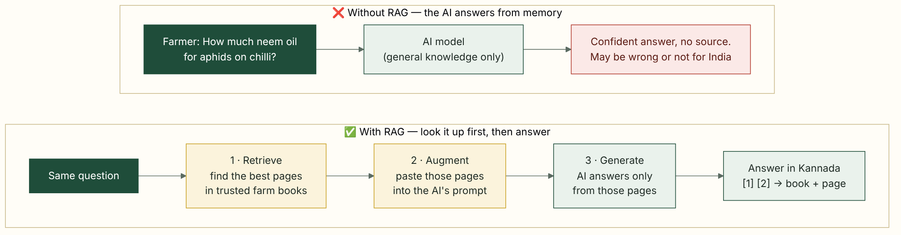
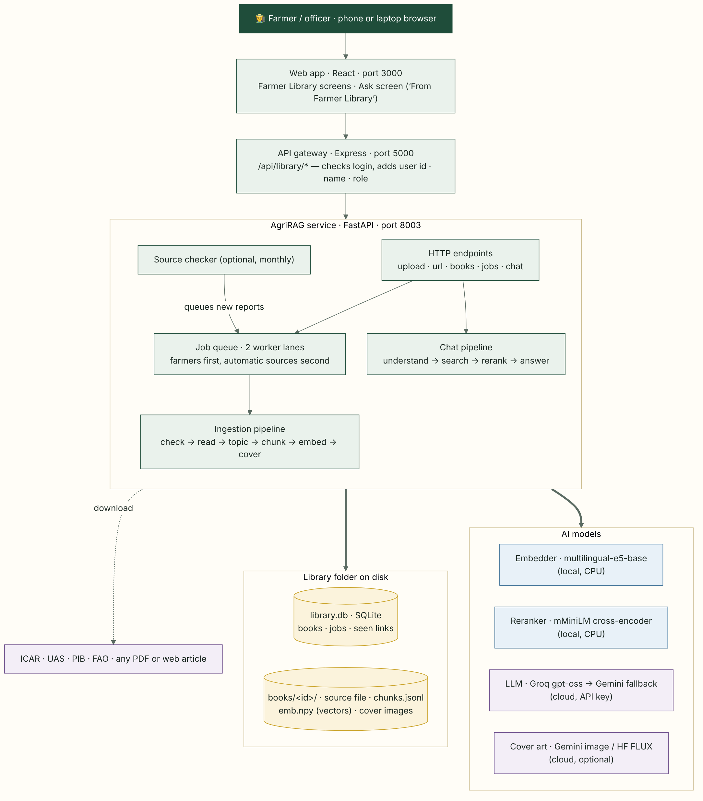
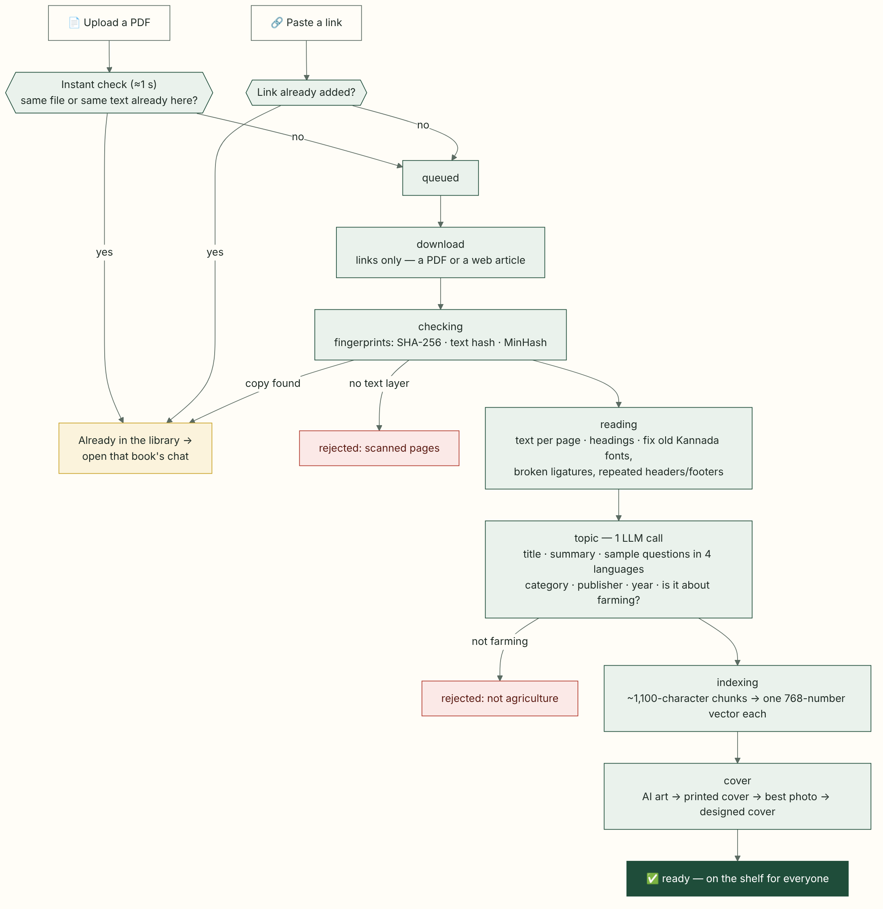
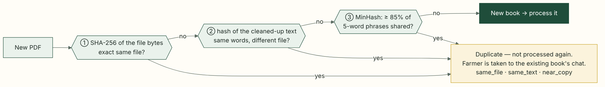
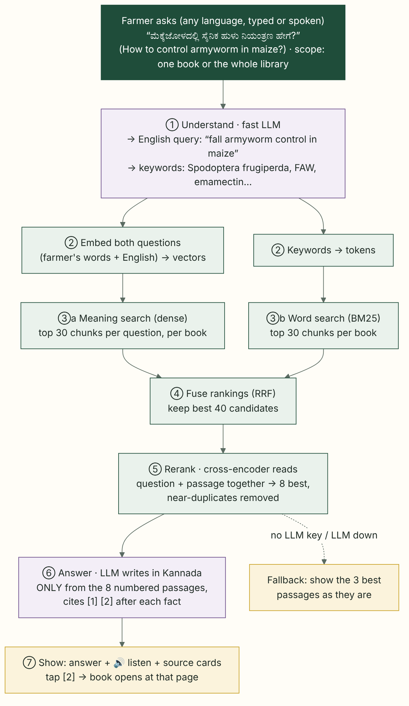

# How AgriRAG works — the Farmer Library, end to end

> **In one line:** AgriRAG turns trusted farm documents (ICAR reports, UAS manuals, advisories, articles) into "books" on a shelf, and answers a farmer's question **in their own language, using only those books, with the page number for every fact**.

This guide is written for someone who has never heard of RAG. Read it top to bottom once. After that, the diagrams alone should be enough.

**Contents**

1. [Prerequisites: ideas you need first](#1-prerequisites-ideas-you-need-first)
2. [Problem statement: why AgriRAG was built](#2-problem-statement-why-agrirag-was-built)
3. [Vision](#3-vision)
4. [RAG in one picture](#4-rag-in-one-picture)
5. [Architecture: the moving parts](#5-architecture-the-moving-parts)
6. [Adding a book: the ingestion pipeline](#6-adding-a-book-the-ingestion-pipeline)
7. [Never the same book twice: deduplication](#7-never-the-same-book-twice-deduplication)
8. [Answering a question: the chat pipeline](#8-answering-a-question-the-chat-pipeline)
9. [Design decisions, and why](#9-design-decisions-and-why)
10. [Where things live: code, data and API](#10-where-things-live-code-data-and-api)
11. [Settings you can change](#11-settings-you-can-change)
12. [Limits and what comes next](#12-limits-and-what-comes-next)

---

## 1. Prerequisites: ideas you need first

### 1.1 The big ideas, with a library analogy

Imagine a village library with a very good **librarian** and a very good **writer**.

* You ask: *"How do I control armyworm in maize?"*
* The **librarian** doesn't know the answer by heart. They know *where to look*, so they bring you the 8 most relevant pages from the shelf.
* The **writer** reads only those 8 pages and writes a short, simple answer in Kannada. After each fact they write a footnote, for example *[2] = ICAR handbook, page 14*.

That is RAG. In AgriRAG:
* the librarian is the **retrieval** part (embeddings, keyword search, a reranker);
* the writer is the **LLM** (a large language model such as Groq's gpt-oss or Google's Gemini).

### 1.2 Terms used in this document

| Term | Plain meaning | Where it appears in AgriRAG |
|---|---|---|
| **LLM** (large language model) | An AI that reads and writes text. It is fluent, but it answers from memory and can be confidently wrong. | Groq `gpt-oss-120b` writes answers. Groq `gpt-oss-20b` rewrites questions. Gemini is the fallback. |
| **Hallucination** | When an LLM makes up a fact, for example a wrong pesticide dose. | Prevented by "answer only from the numbered pages" and by citations. |
| **RAG** (Retrieval-Augmented Generation) | **Retrieve** relevant text first, **augment** (add) it to the prompt, then let the LLM **generate** an answer from it. | The whole chat pipeline (§8). |
| **Prompt** | The instructions plus the text we send to an LLM. | `chat.py` holds `UNDERSTAND` and `ANSWER`; `meta.py` holds `SYSTEM`. |
| **Ingestion** | Turning a raw file into something searchable: read it, clean it, cut it into pieces, index it. | The job pipeline (§6). |
| **Text layer** | The real, selectable text inside a PDF. A scanned PDF is only pictures of pages and has no text layer. | Scanned PDFs are rejected unless OCR is installed. |
| **OCR** | Optical Character Recognition: reading text out of an image. | Optional. Used only if Tesseract is installed. |
| **Legacy font** | Old Kannada/Hindi typing systems (Nudi, Baraha, Kruti Dev) that store Latin letters but *display* Indian script. Copying the text gives gibberish. | Nudi/Baraha Kannada is converted to Unicode. Fonts that can't be converted are skipped. |
| **Chunk** | A small piece of a document (here about 1,100 characters, a long paragraph). We search chunks, not whole books. | `chunking.py`. Each chunk keeps its **page number** and **section heading**. |
| **Embedding / vector** | A list of numbers (here **768** of them) that captures the *meaning* of a text. Texts with similar meaning get similar numbers, even in different languages. | Model `intfloat/multilingual-e5-base`, stored in `emb.npy`. |
| **Cosine similarity** | A score for how alike two vectors are: 1 means the same meaning, 0 means unrelated. | Dense (meaning) search. |
| **Dense search** (semantic search) | Find chunks whose *meaning* is close to the question's meaning. It catches paraphrases ("stem borer" ≈ "dead heart in paddy"). | `BookIndex.dense()`. |
| **Keyword search / BM25** | Classic search that scores chunks by shared *words*, giving more weight to rare words. It is great for exact names ("Spodoptera", "DAP", "Ragi MR-6"). | `BookIndex.bm25()`. |
| **Hybrid search** | Run dense and keyword search together, because each catches what the other misses. | `chat.search()`. |
| **RRF** (Reciprocal Rank Fusion) | A simple way to merge several ranked lists. A chunk ranked high in *any* list gets a good combined score. Formula: `score = Σ 1/(60 + rank)`. | Merges dense and BM25 results. |
| **Reranker** (cross-encoder) | A second, slower but sharper model. It reads the question and one passage *together* and scores how well the passage answers it. | `mmarco-mMiniLMv2-L12-H384-v1` (multilingual), applied to the top 40 candidates. |
| **Bi-encoder vs cross-encoder** | A bi-encoder embeds the question and the passages separately: fast, but rough. A cross-encoder reads each pair together: slow, but accurate. AgriRAG uses the bi-encoder to *find* and the cross-encoder to *sort*. | Embedder vs reranker. |
| **Vector index / vector database** | Where vectors are stored and searched. It can be a big server (FAISS, Qdrant, Pinecone) or just a file. | One small file per book (`emb.npy`). §9 explains why. |
| **Citation / grounding** | Linking each sentence of the answer to the passage it came from. | `[n]` markers that become tappable page links. |
| **Hash (SHA-256)** | A fingerprint of a file's exact bytes. Change one byte and the hash changes completely. | Detects an exact duplicate, even if renamed. |
| **MinHash / Jaccard similarity** | A quick way to estimate how much two long texts overlap (Jaccard = shared ÷ total), without comparing them word by word. | Detects near-copies (≥ 85% overlap). |
| **Metadata** | Facts *about* a document: title, summary, category, publisher, year. | One LLM call per book, in 4 languages. |
| **Job queue / worker** | A to-do list of books to process, and a background loop that works through it one item at a time, so the website never freezes. | `pipeline.py`. Two lanes, with farmers' uploads first. |
| **API gateway** | The one front door for the web app. It checks who is logged in and forwards the request to the right service. | Express (`services/api`) forwards `/api/library/*` to AgriRAG. |

---

## 2. Problem statement: why AgriRAG was built

Good farming knowledge already exists in India. It just doesn't reach the farmer in a form they can use.

| Problem | What it looks like in practice |
|---|---|
| **Knowledge is locked in long PDFs** | ICAR annual reports, UAS packages of practices and IMD bulletins run to 50–600 pages, and most are in English. A farmer with a pest outbreak won't read page 214 of an annual report. |
| **It is scattered** | It sits on ICAR, UAS, IIMR, CPCRI, PIB, FAO, NDDB and IMD sites, each with its own layout. There is no one place to look. |
| **Language and literacy** | Many farmers are most comfortable in Kannada, Hindi or Telugu, and often prefer listening to reading. Some Kannada PDFs use old Nudi fonts that even copy-paste can't read. |
| **General chatbots are risky** | A general AI may invent a dose or a chemical name, or give advice for another country. In farming, a wrong dose costs a crop, money or health. |
| **No way to check** | Even a correct answer isn't trusted if the farmer or the extension officer can't see where it came from. |
| **Duplicates and noise** | When many people upload, the same report arrives again and again (renamed or re-saved), along with files that have nothing to do with farming. |
| **New reports keep coming** | Monthly bulletins, annual reports and pest alerts appear all the time, so the library has to grow without manual re-engineering. |
| **Modest hardware** | The project must run on a normal laptop CPU, without a paid vector database or GPU. |

The old AgriRAG service answered from a fixed, pre-built set of manuals. Farmers couldn't add documents, pick a book, see covers, or check citations.

---

## 3. Vision

> **An "OTT for farm knowledge"**: every trusted agricultural document in India becomes a book on a shelf that any farmer can browse, listen to and question in their own language. Every answer points back to the exact page it came from.

What that means in practice:

* **Trust before fluency.** The AI answers *only* from the books and cites every fact. If the books don't say it, it says so and suggests the local Krishi Vigyan Kendra.
* **Your language, your way.** Ask by voice or text in Kannada, Hindi, Telugu or English. The answer comes back in that language, read aloud on request.
* **Built by the community, kept clean by the system.** Farmers and officers add PDFs and links. The system rejects duplicates and non-farming files, and officers can hide anything unsuitable.
* **Always growing.** Annual reports, monthly bulletins and new advisories can flow in automatically (optional monthly check of ICAR, UAS and other sources).
* **Runs anywhere.** One laptop, local models, plain files. Cloud AI is used only to write answers, and the system still shows the best passages when the cloud is unavailable.

---

## 4. RAG in one picture



AgriRAG has **two pipelines**:

| Pipeline | When it runs | What it does |
|---|---|---|
| **Ingestion** ("adding a book") | Once per document, in the background | Reads it → cleans it → splits it into chunks → turns chunks into vectors → makes a title, summary and cover |
| **Chat** ("asking a question") | Every time someone asks | Understands the question → finds the best chunks → asks the LLM to answer from them → shows citations |

---

## 5. Architecture: the moving parts



| Part | Technology | Job |
|---|---|---|
| **Web app** | React (port 3000) | Farmer Library screens: shelves, book page, **Add a book**, book chat. The **Ask** screen's *From Farmer Library* mode reuses the same chat. |
| **API gateway** | Express (port 5000) | Single front door. It reads the login token (if any) and forwards `/api/library/*` to AgriRAG, adding `X-User-Id`, `X-User-Name` and `X-User-Role`. It streams uploads straight through. |
| **AgriRAG service** | FastAPI (port 8003) | Everything in this document: endpoints, job queue, ingestion, chat, the optional source checker. |
| **Catalog** | SQLite (`library.db`) | Tables `books`, `jobs`, `seen_urls` and `settings`. |
| **Book folders** | Plain files | `books/<id>/` contains `source.pdf` (or `.html`), `chunks.jsonl`, `emb.npy`, `art.jpg` and `page.jpg`. |
| **Local models** | sentence-transformers on CPU | Embedder (`multilingual-e5-base`) and reranker (`mmarco-mMiniLMv2`). Downloaded once, then offline. |
| **Cloud models** | Groq, with Gemini as fallback | Question rewriting, answer writing, book metadata. Optional cover art (Gemini image or Hugging Face FLUX). |

---

## 6. Adding a book: the ingestion pipeline

A farmer taps **Add a book** and either uploads a PDF (up to 80 MB and 600 pages) or pastes a link to a PDF or a web article.



### 6.1 Each stage, and why it exists

| Stage (shown in the UI) | What happens | Why |
|---|---|---|
| **Instant check** (before queueing) | The upload streams to disk. We compute the file's SHA-256 and a quick text sample and compare them with the library. Links are compared with the links already added. | The farmer learns *in about a second* that the book already exists and is sent straight to its chat. No waiting, no wasted CPU. |
| **queued** | A job row is created. There are **two worker lanes**: farmers' uploads and links in one, automatic sources in the other. | A farmer's book is never stuck behind a 600-page automatic report. |
| **download** (links only) | Fetch the URL, using the system certificate store. If it is a PDF, process it as a PDF. Otherwise extract the article text with `trafilatura`, split into "pages" of about 2,500 characters. | Lets people add web articles (TNAU, Vikaspedia…) as books. |
| **checking** | Full duplicate check (§7). If the PDF has almost no text, it is a scan and is rejected unless OCR is installed. | Keeps the shelf clean and avoids empty books. |
| **reading** | PyMuPDF reads text per page. Headings are detected by font size. Repeated headers and footers are removed. Broken ligatures are fixed (`�eld` → `field`) and drop-caps merged. **Nudi/Baraha Kannada** is converted to Unicode. Text in unsupported legacy fonts is skipped. | Clean text is the foundation: bad text in means bad answers out. |
| **topic** | **One LLM call** reads samples of the book and returns: a title, a 2-sentence summary and 4 sample questions in **English, Hindi, Kannada and Telugu**; a category (11 shelves); document type, publisher, year, crops and topics; whether it is about agriculture, with a confidence score. If no LLM is available, a keyword-based fallback fills these in. | Gives the shelf readable titles in every language, ready-made question suggestions, and an **agriculture check**: uploads that are *not farming* with confidence below 0.4 are rejected. |
| **indexing** | Split into chunks of about 1,100 characters (max 1,700) that keep their **page** and **section**. Garbled chunks are dropped. Each chunk is prefixed with the book title and section, then turned into a **768-number vector**. Vectors are saved as `emb.npy` (normalised, float16) and chunk text as `chunks.jsonl`. | Small chunks make search precise. Keeping the page number makes citations possible. Adding the title and section to the text helps search find the right book. |
| **cover** | Tried in order: **AI art** (if an image key is set) → the **printed front cover** (page 1, or its front half if it's a wrap-around cover) → the **best photo** inside the PDF → otherwise the app draws a **designed cover** (colour and icon by category). | Covers make the library feel like an OTT shelf and help farmers recognise books. |
| **ready** | The book row is saved and the book appears on everyone's shelves. | — |

### 6.2 Job states

| State | Meaning | What the farmer sees |
|---|---|---|
| `queued` → `download` → `checking` → `reading` → `topic` → `indexing` → `cover` | Working | A card in **Being added** with a progress ring |
| `ready` | Done | The new book on the shelf |
| `duplicate` | Already in the library | "Already in the library", with a button to open that book's chat |
| `rejected` | Scanned with no text, or not about agriculture | The reason, in their language |
| `cancelled` | Stopped by the uploader or an officer (✕) | The card disappears |
| `failed` | Unexpected error, for example a network failure | An error message. They can try again. |

---

## 7. Never the same book twice: deduplication

The rule: **content decides, not the file name.** A renamed, re-saved or slightly stamped copy of a book is the same book.



| Check | Catches | Cost |
|---|---|---|
| ① **SHA-256 of the bytes** | The exact same file under a different name | Microseconds |
| ② **Hash of the normalised text** (lower-case, punctuation and spaces removed) | The same words in a different file: re-exported, compressed, new metadata | Milliseconds |
| ③ **MinHash** (128 permutations over 5-word phrases), with Jaccard ≥ 0.85 | Near-copies: an extra stamped page, a corrected typo, a different cover | Milliseconds per book |
| **Same link** (`seen_urls`) | The same URL pasted again | Microseconds |

On a match, the book is **not processed again**. The app takes the farmer straight to that book's chat, so their question still gets answered.

---

## 8. Answering a question: the chat pipeline

The farmer chooses the **scope**:
* **one book** (open a book → ask);
* **the whole library** (*Ask the whole library*, or **Ask → From Farmer Library**).



### 8.1 Step by step

| # | Step | What happens | Why |
|---|---|---|---|
| ① | **Understand** | A fast LLM reads the question (any language) and the last few chat turns. It returns a **standalone English query** ("it" becomes "fall armyworm") plus **4–10 keywords**, including scientific and local names. | Most books are in English. Translating the *question* (not the books) makes Kannada, Hindi and Telugu questions find English pages. Follow-ups like "what about its dose?" work too. |
| ② | **Embed and tokenise** | Both the farmer's own words and the English query become vectors. The question and keywords become search tokens. | Two phrasings give two chances to match. |
| ③ | **Hybrid search, per book** | Dense search takes the top 30 chunks by meaning, for each phrasing. BM25 takes the top 30 chunks by words. This runs for every book in scope. | Meaning search catches paraphrases. Word search catches exact names, varieties and chemicals. |
| ④ | **Fuse (RRF)** | Merge all lists with `Σ 1/(60 + rank)` and keep the **best 40** candidates across all books. | Simple and robust. No score tuning needed between very different searches. |
| ⑤ | **Rerank** | The cross-encoder scores each of the 40 against the question. It runs against both phrasings and keeps the better score. Near-duplicate passages are removed and the **top 8** kept. | Puts the passage that *actually answers* the question first. |
| ⑥ | **Answer** | The LLM gets the 8 passages numbered `[1]…[8]` (book, page, section), short book descriptions and the recent chat. Its rules: write in the farmer's language, use simple words, cite `[n]` after each fact, never invent doses or chemicals, and say plainly if the books don't cover it. | This is where "grounded" comes from. Only cited sources are returned to the app. |
| ⑦ | **Show** | Answer text with tappable `[n]` chips, a **Listen** button, and source cards. Tapping a card opens the PDF **at that page** (articles open their web page). | The farmer or officer can check every fact. |

**If there is no LLM** (no API key, or the service is down), the farmer still gets the **3 best passages** as they are, with page links, plus a note that the AI writer is unavailable.

### 8.2 A worked example (illustrative)

**Question** (Kannada, whole library):
> ಮೆಕ್ಕೆಜೋಳದಲ್ಲಿ ಸೈನಿಕ ಹುಳು ನಿಯಂತ್ರಣ ಹೇಗೆ? (*How to control armyworm in maize?*)

1. **Understand** produces:
   - English query: `fall armyworm control in maize`
   - keywords: `Spodoptera frugiperda, FAW, maize whorl, egg masses, emamectin benzoate, pheromone traps, neem`
2. **Search** finds candidate passages in the FAO fall armyworm guide, the IIMR millets bulletin and an ICAR advisory. The reranker puts the FAO passages on scouting and control thresholds first.
3. **Answer**: a short Kannada answer with bullet points:
   - scout the whorls;
   - crush egg masses;
   - use pheromone traps;
   - the dose exactly as the book gives it.

   Each point ends in `[1]`, `[2]` and so on.
4. **Sources** show, for example, *[1] FAO — Integrated management of fall armyworm on maize · p. 42*. Tapping it opens that page.

---

## 9. Design decisions, and why

| Decision | Alternatives considered | Why we chose this |
|---|---|---|
| **One small index per book** (`chunks.jsonl` + `emb.npy` + in-memory BM25) instead of one big vector database | A FAISS index for the whole library, or a Qdrant/Chroma server | "Chat with this book" only touches that book, so no other book can leak in. Hiding or removing a book never rewrites anyone else's index. Dedup and covers live with the book. No extra server to install on a farmer-centre laptop. |
| **Exact (brute-force) vector search** | Approximate search (HNSW/IVF) | A laptop library of tens of books and up to about 100k chunks fits in memory. Exact search is fast enough and never misses, and there is nothing to tune. Move to FAISS or Qdrant when the library grows to hundreds of thousands of chunks. |
| **Hybrid search (dense + BM25) + RRF + reranker** | Dense search only | Farm questions are full of exact names (varieties, pests, chemicals) that dense search blurs. BM25 keeps them sharp, and the reranker fixes the order. |
| **Translate the question, not the books** | Translating every book into 4 languages | Translating a 600-page book costs a lot. Rewriting a 15-word question costs almost nothing. A multilingual embedder and reranker do the rest. |
| **`multilingual-e5-base` embedder** | `bge-m3`, `e5-small` | `bge-m3` took about 0.76 s per chunk on CPU, which is too slow for big reports. e5-base is a good middle ground between quality and speed in Indian languages. |
| **Metadata in one LLM call per book** | Many calls, or a manual form | It is cheap. It gives titles, summaries and questions in all 4 languages, plus the agriculture check. A keyword fallback keeps working offline. |
| **SQLite + plain folders** | Postgres or Mongo for the library | Zero setup, and a single folder to back up or copy. The rest of the platform still uses Mongo for users and alerts. |
| **Two worker lanes** | One queue | A farmer's 5-page leaflet is never stuck behind a 600-page annual report. |
| **Automatic sources off by default** | Auto-seed and auto-crawl on start-up | On a laptop, big automatic downloads slowed everything down. Officers add books on purpose; the monthly check can be switched on (`LIBRARY_AUTOSEED`, `LIBRARY_CRAWL_DAYS`). |
| **Public after an automatic check; officers can hide** | Officer approval for every upload | The library grows quickly, and the agriculture check plus duplicate checks stop most noise. |

---

## 10. Where things live: code, data and API

### 10.1 Code map (`services/agri-rag/`)

| File | Responsibility |
|---|---|
| `app.py` | FastAPI app, endpoints, start-up (workers, model warm-up, scheduler) |
| `library/config.py` | All settings (environment variables) and folders |
| `library/store.py` | SQLite catalog: books, jobs, seen links, settings |
| `library/pipeline.py` | Job queue, the two worker lanes, `process()` (all ingestion stages), duplicate checks, cancel |
| `library/extract.py` | PDF and article text extraction, clean-up, legacy fonts, cover-page and photo picking |
| `library/fingerprint.py` | SHA-256, text hash, MinHash and Jaccard |
| `library/chunking.py` | Page-aware chunking (~1,100 characters) with section headings |
| `library/embed.py` | Embedder and reranker (loaded once, thread-safe) |
| `library/index.py` | Per-book index: save and load, dense search, BM25 |
| `library/meta.py` | Book metadata prompt, categories, keyword fallback |
| `library/llm.py` | Groq → Gemini calls, with JSON mode |
| `library/chat.py` | Understand → search → rerank → answer |
| `library/covers.py` | Cover chain: AI art → printed cover → photo → none |
| `library/net.py` | Downloads, certificate handling, finding PDF links on pages |
| `library/sources.py` + `sources.json` | Starter shelf, monthly source check, import of old AgriRAG PDFs |

Frontend: `apps/web/components/Library.tsx` (shelves, book view, Add a book, `BookChat`), `apps/web/components/ChatModule.tsx` (the Ask screen and its *From Farmer Library* mode) and `apps/web/services/libraryService.ts`.

### 10.2 Data on disk

The library folder is `%LOCALAPPDATA%\AgriQNet\library` on Windows. Set `LIBRARY_DIR` to change it.

```
library/
├── library.db              # catalog (SQLite)
├── incoming/               # uploads while they are processed
└── books/<book id>/
    ├── source.pdf | .html  # the original
    ├── chunks.jsonl        # one line per chunk: {i, page, section, text}
    ├── emb.npy             # vectors, normalised float16, one row per chunk
    ├── art.jpg             # cover (AI art / printed cover / photo)
    └── page.jpg            # first page thumbnail
```

### 10.3 API

The web app calls these through the gateway as `/api/library/...`. The service itself serves `/library/...` on port 8003.

| Method and path | Purpose |
|---|---|
| `GET /library/books` | Shelf: books, the "being added" queue, last source check |
| `GET /library/books/{id}` · `/cover` · `/file` | One book, its cover, its PDF (articles redirect to the web page) |
| `POST /library/upload` | Upload a PDF. Returns `duplicate`, `rejected` or a queued job. |
| `POST /library/url` | Add a PDF or article link |
| `GET /library/jobs/{id}` | Progress of one job |
| `POST /library/jobs/{id}/cancel` | Stop a job (uploader or officer) |
| `POST /library/chat` | `{message, lang, bookIds?, history}` returns `{answer, sources[], queryEn}` |
| `POST /library/books/{id}/hide` | Officer only: hide or unhide a book |
| `POST /library/sources/check` · `/jobs/cancel-automatic` | Officer only: check sources now, or stop automatic adding |
| `GET /health` | Service status |

---

## 11. Settings you can change

Set these in the platform `.env` file.

| Variable | Default | Effect |
|---|---|---|
| `GROQ_API_KEY` / `GEMINI_API_KEY` | – | Enables written answers and metadata. Without them: extractive answers and keyword metadata. |
| `GROQ_MODEL` / `GROQ_FAST_MODEL` | `openai/gpt-oss-120b` / `openai/gpt-oss-20b` | The answer writer / the question rewriter |
| `RAG_EMBED_MODEL` | `intfloat/multilingual-e5-base` | The embedder. Changing it requires re-indexing the books. |
| `RAG_RERANK_MODEL` | `cross-encoder/mmarco-mMiniLMv2-L12-H384-v1` | `none` turns the reranker off (faster, less precise) |
| `LIBRARY_MAX_MB` / `LIBRARY_MAX_PAGES` | 80 / 600 | Upload limits |
| `LIBRARY_NEAR_DUP` | 0.85 | MinHash similarity treated as "the same book" |
| `COVER_AI`, `GEMINI_IMAGE_MODEL`, `HF_TOKEN` | `auto`, –, – | AI cover art (optional) |
| `LIBRARY_AUTOSEED` | `false` | Add the starter shelf automatically on first start |
| `LIBRARY_CRAWL_DAYS` | `0` | For example, `30` checks ICAR, UAS and other sources monthly. `0` never checks. |
| `LIBRARY_DIR` | per-user app-data folder | Where the library is stored |

---

## 12. Limits and what comes next

| Today | Next step |
|---|---|
| Scanned PDFs are rejected unless Tesseract OCR is installed | Bundle OCR (Kannada, Hindi and Telugu models) for scanned extension leaflets |
| Kruti Dev / Shree-Lipi / AnmolLipi text is skipped | Add converters for more legacy fonts |
| Weekly bulletins reuse one URL, so re-pasting it counts as a duplicate | Treat "same link, new content" as a new edition |
| Exact search for every question across all books | Switch to FAISS or Qdrant past about 100k chunks; cache frequent questions |
| Answers need a cloud LLM (otherwise passages only) | A small local LLM for fully offline answers |
| Embedding a 300-page report takes minutes on CPU | Use a GPU when available; use a smaller embedder for very large files |
| Four languages | Add Marathi, Tamil and more. The models are already multilingual, so mainly the UI and prompts need work. |

---

*Diagram sources (Mermaid) are in [`docs/diagrams/`](diagrams/). To re-render them after editing:*
`mmdc -i docs/diagrams/03-ingestion.mmd -o docs/img/03-ingestion.png -c docs/diagrams/theme.json -b "#FFFDF7" -s 2 -w 1100`
